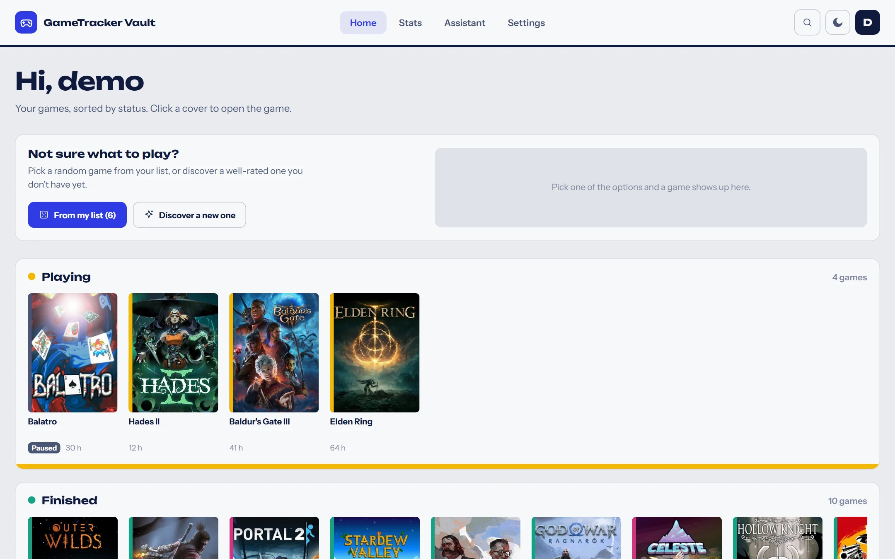
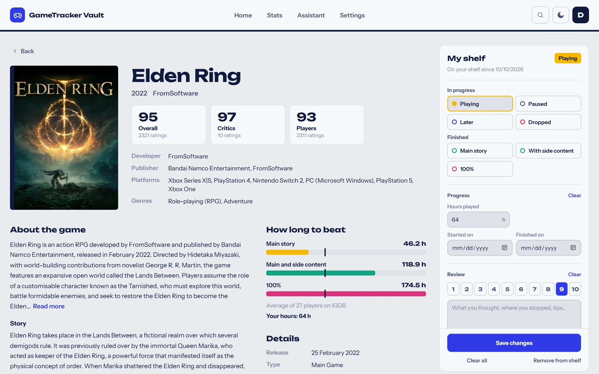
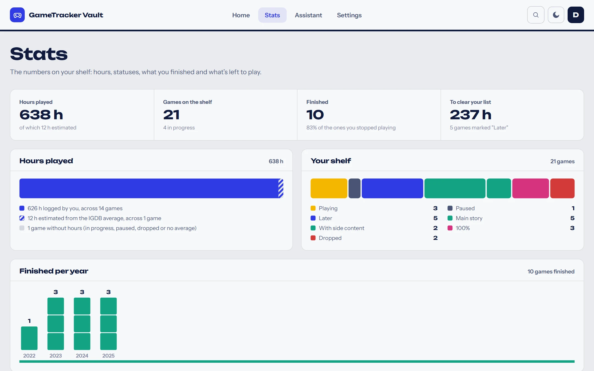
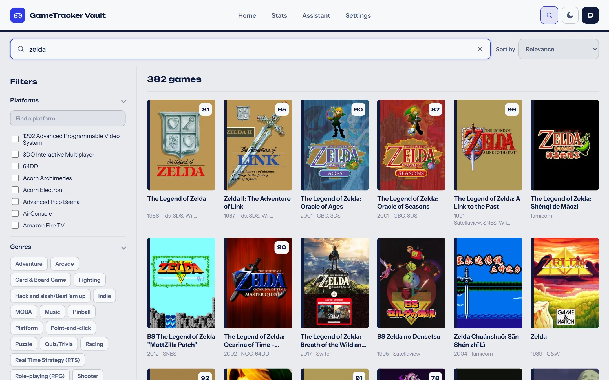
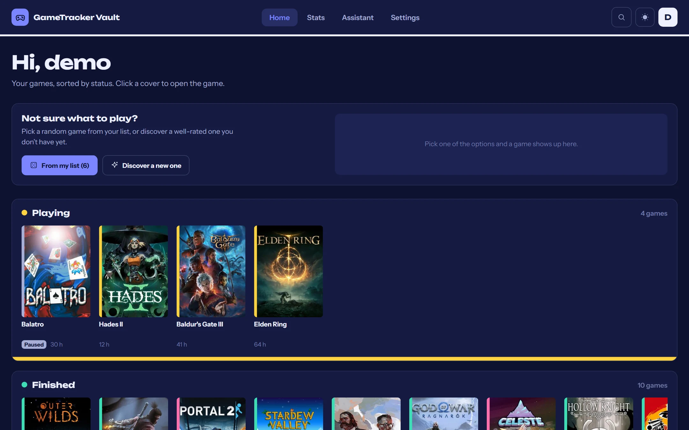
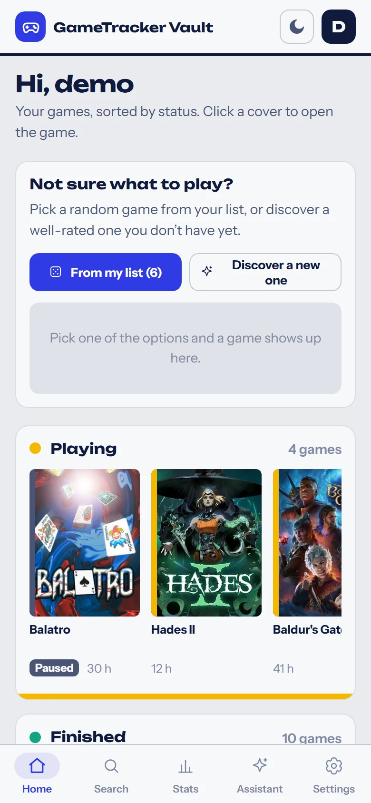
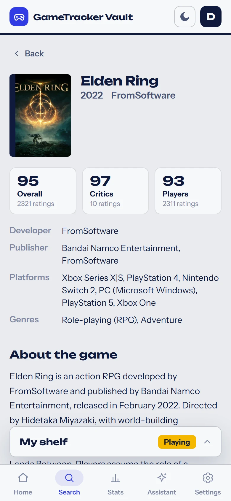
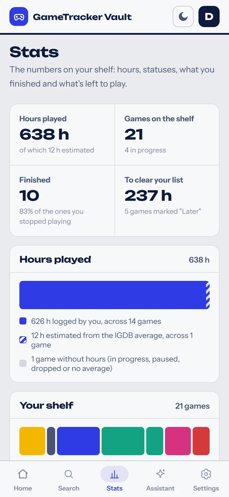
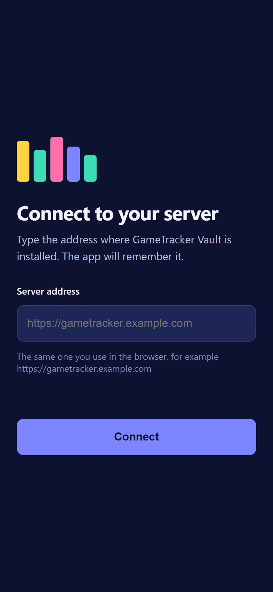

# GameTracker Vault

*[English](./README.md)*

Registo pessoal de jogos para alojar em casa (self-hosted). Cada pessoa tem a sua
estante — o que está a jogar, o que acabou, o que passou e o que quer jogar — com horas,
datas, nota e notas, e a ficha de cada jogo vem do catálogo do IGDB. Corre num container
do Proxmox (ou numa máquina Debian), com a base de dados lá dentro; os teus dados não
saem do teu servidor.



## O que tem

- **Pesquisa no IGDB** com filtros (plataformas, géneros, temas, modos, anos, nota…) e
  a página de cada jogo: capa, resumo, galeria, vídeos, tempos médios para acabar.
- **Estante pessoal** em quatro prateleiras: a jogar, para jogar, acabados e passados.
- **Estatísticas**: horas, jogos por estado, género e ano, e as tuas notas. Onde não
  escreveste as horas, usa os tempos médios do IGDB.
- **Jogo ao calhas**: um da tua lista ou um bem avaliado que ainda não tens.
- **Assistente com o Claude** (opcional): conversa sobre jogos e recomenda a partir da
  tua estante e das tuas notas. Cada utilizador usa a sua chave da Anthropic.
- **Vários utilizadores**, cada um com a sua estante; o admin cria as contas.
- **App Android** ligada ao teu servidor, que se atualiza sozinha.
- **Atualizações com um clique** no painel de Admin, com regresso automático à versão
  anterior se algo falhar.
- Interface em português, inglês e espanhol, tema claro e escuro, pensada também para
  o telemóvel.

## Capturas de ecrã

<table>
  <tr>
    <td width="50%"></td>
    <td width="50%"></td>
  </tr>
  <tr>
    <td align="center">Página de um jogo com o painel da estante</td>
    <td align="center">Estatísticas</td>
  </tr>
  <tr>
    <td></td>
    <td></td>
  </tr>
  <tr>
    <td align="center">Pesquisa no IGDB com filtros</td>
    <td align="center">Tema escuro</td>
  </tr>
</table>

<table>
  <tr>
    <td width="25%"></td>
    <td width="25%"></td>
    <td width="25%"></td>
    <td width="25%"></td>
  </tr>
  <tr>
    <td align="center">Telemóvel: início</td>
    <td align="center">Telemóvel: página de um jogo</td>
    <td align="center">Telemóvel: estatísticas</td>
    <td align="center">App Android: primeiro arranque</td>
  </tr>
</table>

## Instalar

**Precisas de:** um host Proxmox VE com acesso à internet. O container por omissão
leva 2 CPUs, 2 GB de RAM e 16 GB de disco.

Na Shell do host do Proxmox (Datacenter → nó → Shell):

```bash
bash -c "$(curl -fsSL https://raw.githubusercontent.com/TTiagoSousa/gametrackervault/main/deploy/proxmox/ct-create.sh)"
```

Um menu pergunta o essencial (ou aceita tudo por omissão), cria um container Debian 13
e instala a última versão: PostgreSQL, Node, nginx e o backend como serviço. No fim
mostra o endereço da app.

Sem Proxmox, numa VM ou servidor Debian 13, ver
[Sem Proxmox](./deploy/proxmox/README.pt-PT.md#sem-proxmox-vm-ou-servidor-debian-13). O guia
completo — IP estático, VLAN, domínio, configuração, manutenção — está em
[`deploy/proxmox/README.pt-PT.md`](./deploy/proxmox/README.pt-PT.md).

## Primeiros passos

1. **Entra com `admin` / `admin`** e troca logo a password em **Definições → Conta**.
2. **Liga o catálogo de jogos.** Sem isto a pesquisa não funciona. Cria uma aplicação
   na [consola da Twitch](https://dev.twitch.tv/console/apps) (tipo *Confidential*; o
   IGDB usa as contas da Twitch) e põe o Client ID e o Client Secret em
   **Admin → Catálogo de jogos (IGDB)**. É gratuito, uma chave para toda a instalação.
3. **Cria as contas** das outras pessoas em **Admin → Utilizadores**.
4. **Assistente (opcional).** Cada utilizador põe a sua chave da
   [Anthropic](https://console.anthropic.com/) em **Definições → Assistente** e escolhe
   o modelo.
5. **Domínio e HTTPS (opcional).** Aponta um proxy (Nginx Proxy Manager, Caddy,
   Traefik…) para `http://<IP do container>:80` e muda o endereço da app com
   `gametracker-config` dentro do container.

A página **Ajuda** da app explica cada um destes passos com mais detalhe.

## Atualizar e backups

- **Atualizar:** **Admin → Versão → Atualizar**, ou `gametracker-update` dentro do
  container. Segue as versões publicadas (tags `vX.Y.Z`); as notas de cada uma
  aparecem na app e estão em [`releases/`](./releases).
- **Backups:** a base de dados é copiada todos os dias às 03:30 para
  `/var/backups/gametracker` (guarda 14 dias). Para repor, ver
  [Manutenção](./deploy/proxmox/README.pt-PT.md#5-manutenção).
- **Não percas** `/root/gametracker-credentials.txt` (dentro do container): tem a chave
  que cifra os segredos guardados (a do IGDB, as dos assistentes).

## App Android

**[Descarregar o APK](https://github.com/TTiagoSousa/gametrackervault/raw/main/apps/frontend/public/downloads/gametracker-vault.apk)**
(Android 8 ou mais recente), ou na própria app, em **Ajuda → App Android**, servido
pelo teu servidor.

Abre o ficheiro no telemóvel, permite instalar apps dessa origem se o Android pedir e
carrega em **Instalar**. Na primeira vez escreve o endereço do teu servidor (o mesmo do
browser). A interface vem sempre do servidor; quando sair um APK novo, a app oferece-se
para se atualizar.

## Privacidade

Tudo o que escreves fica na base de dados do teu servidor. Para fora só saem:

- os pedidos ao **IGDB** (pesquisas e fichas de jogos), feitos pelo servidor;
- as imagens de capas e vídeos, carregadas pelo browser a partir do IGDB e do YouTube;
- as conversas com o **assistente**, enviadas à Anthropic com a chave de quem o usa —
  e só se essa pessoa o configurar. Incluem a estante dessa pessoa, para as
  recomendações.

## Desenvolvimento

```bash
npm install
cp apps/backend/.env.example apps/backend/.env   # e preencher
npm run dev
```

Requer Node 22+ e um PostgreSQL. Backend em NestJS + Prisma, frontend em React + Vite,
app Android em Java (WebView). Comandos, convenções e fluxo de releases em
[`CONTRIBUTING.md`](./CONTRIBUTING.md); documentação técnica (em inglês) em
[`docs/`](./docs/README.md).

| Pasta | O quê |
|---|---|
| `apps/backend` | API NestJS + Prisma + PostgreSQL |
| `apps/frontend` | SPA React + Vite |
| `apps/android` | app Android (WebView ligada ao teu servidor) |
| `packages/shared` | tipos e constantes usados pelos dois |
| `deploy/proxmox` | instalador (container LXC ou Debian 13) e atualizações |
| `releases` | notas de cada versão (en, pt-PT, es) |
| `docs` | documentação técnica e as capturas de ecrã |

## Licença

[PolyForm Noncommercial 1.0.0](./LICENSE.md) (texto oficial em inglês). Podes alojar,
usar e alterar à vontade para qualquer fim não comercial — em casa, para amigos, num
clube ou numa escola. Não é permitido vendê-la, oferecê-la como serviço pago nem usá-la
dentro de um produto comercial. Se a partilhares, ou uma versão alterada, mantém a
licença e o aviso de copyright e indica este repositório; o mais simples é fazer um fork.
